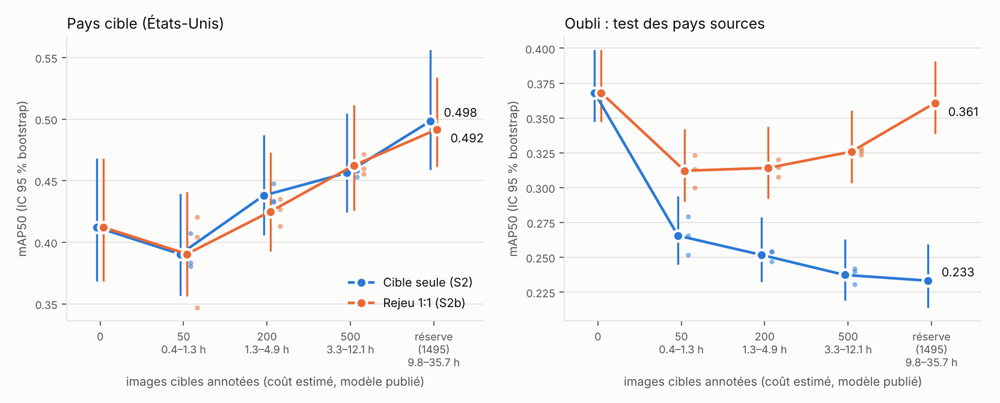
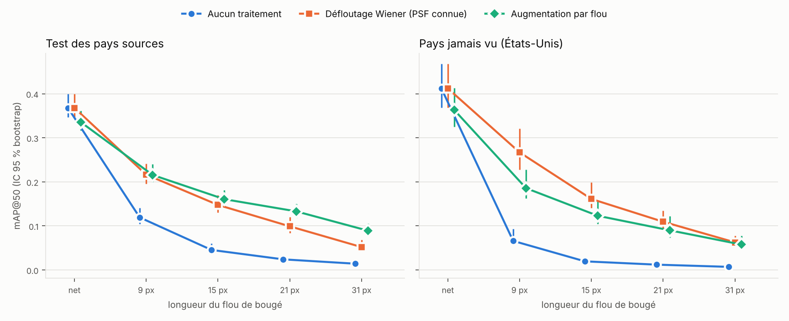

# road-damage-shift

Détection de dégradations de chaussée (fissures longitudinales D00, transversales D10, faïençage D20, nids-de-poule D40) qui reste fiable **dans un pays jamais vu**, **sous le flou de bougé** et **sur CPU**.

> Statut : semaines 1 à 3 terminées (données, baselines, Q1 few-shot, Q2 flou, Q3 CPU). Restent : référence zero-shot, analyse d'erreurs, API, démo. Les `[X]` restants seront remplacés par des résultats d'exécutions réelles tracées dans MLflow.

## Questions de recherche

| # | Question | Coût réel associé |
|---|----------|-------------------|
| Q1 | Combien d'images annotées du pays cible faut-il pour récupérer la performance ? (0 / 50 / 200 / 500) | Coût **estimé** (modèle publié, non mesuré) : 3,3–12,1 h pour 500 images |
| Q2 | Le flou de bougé : défloutage Wiener avant détection ou augmentation par flou à l'entraînement ? | Wiener : 365 ms/image (médiane, CPU), en plus de la détection |
| Q3 | Quelle perte de précision pour quel gain de latence en ONNX / INT8 sur CPU ? | Latence CPU (Kaggle, 4 threads) : 204 ms/image en ONNX FP32, 183 ms en INT8 ; PC personnel : [X] |

## Protocole

- **Données** : RDD2022, train annoté uniquement (le test officiel n'a pas d'annotations publiques).
- **Sources** : Japon + Inde + Tchéquie (70 / 15 / 15 %). **Cibles** : États-Unis (principale), Norvège (si disponible) — 1000 images de test figées + une réserve pour le few-shot.
- **Découpage par blocs** d'images consécutives pour limiter la fuite entre images voisines d'un même trajet.
- **Sélection de modèle** sur la validation source uniquement ; les jeux de test ne servent qu'à la mesure finale.
- **Même budget pour les deux modèles** (données, 50 epochs, batch 8, imgsz 640, seed), mais chacun avec le taux d'apprentissage de sa recette d'origine : YOLO11 en `optimizer: auto` d'Ultralytics (AdamW 0,00125), RT-DETR en AdamW 1e-4 (Zhao et al., CVPR 2024). Avec la recette YOLO, l'entraînement de RT-DETR a divergé (NaN persistant).
- Seeds fixées, empreinte sha256 du manifest de données enregistrée dans chaque run MLflow.

### Protocole Q1 (fixé avant les résultats few-shot)

- Fine-tuning du modèle S1 sur k = 50 / 200 / 500 images américaines (3 tirages imbriqués chacun) et sur toute la réserve (plafond) ; k = 0 = modèle S1 seul.
- 30 epochs pour tous les k, lr = lr S1 / 10 (AdamW), une mise à jour des poids par batch (`nbs` = batch = 8 ; avec l'accumulation par défaut d'Ultralytics, k = 50 n'aurait reçu qu'≈ 36 mises à jour, défaut repéré dans les logs du test de fonctionnement et corrigé avant tout résultat few-shot), seed d'entraînement fixe : la variance mesurée vient du choix des images.
- Aucune image cible en dehors des k annotées n'est utilisée : pas de validation cible, on évalue `last.pt`. Seuil du F1 choisi sur la validation source.
- Mesures avec IC bootstrap : test États-Unis figé (adaptation) et test source (oubli).
- **S2b, rejeu** (fixé après les résultats de S2, avant tout résultat avec rejeu) : mêmes runs, mêmes tirages et même recette, avec en plus autant d'images tirées du **train** source que d'images cibles (ratio 1:1, tirage seedé ; jamais d'image de validation ou de test source). Chaque run S2b est comparé à son jumeau S2 (même k, même tirage) sur les mêmes images de test. Le coût d'annotation est inchangé : les images sources sont déjà annotées.
- **Coût d'annotation estimé, pas mesuré** : 7,8 s par image + 7 à 34,5 s par boîte (Su et al. 2012 ; Papadopoulos et al., ICCV 2017), appliqués aux nombres exacts d'images et de boîtes de chaque sous-ensemble. Ces temps viennent d'objets ImageNet bien délimités ; une fissure fine ou un faïençage est probablement plus long à annoter, la borne haute est donc la plus réaliste.

### Protocole Q2 : flou de bougé (fixé avant les résultats)

- Modèle : YOLO11s S1 (seed 42). Jeux : test source et test États-Unis, floutés à 5 niveaux (0 = images d'origine, puis 9, 15, 21, 31 px).
- Flou de bougé linéaire, angle tiré une fois par image (0°, 45° ou 90°) et identique à tous les niveaux, puis bruit gaussien σ = 1 % ; réenregistrement JPEG (qualité 95). Le niveau « net » est l'image d'origine, sans bruit ni réenregistrement.
- (a) aucun traitement ; (b) défloutage de Wiener avant détection, K = 0,01, **avec le noyau exact** (borne optimiste : en réel il faudrait estimer le flou) ; (c) même recette d'entraînement que S1, avec en plus un `MotionBlur` aléatoire (p = 0,5, 3 à 31 px, angle quelconque) ajouté aux augmentations par défaut d'Ultralytics. Le générateur de flou de (c) diffère de celui du test, mais les intensités sont du même ordre.
- Mêmes images pour toutes les approches : écarts appariés (b − a) et (c − a) à chaque niveau, IC 95 % bootstrap. (c − a) sur images nettes mesure ce que coûte l'augmentation quand il n'y a pas de flou. Le temps de Wiener par image (CPU) est mesuré.

### Protocole Q3 : déploiement sans GPU (fixé avant les résultats)

- Modèle : YOLO11s S1 (seed 42), entrée fixe 640 × 640. Trois versions : PyTorch FP32, ONNX FP32 (opset 17), ONNX INT8.
- INT8 : quantification statique onnxruntime au format QDQ des **convolutions uniquement**, poids INT8 par canal, activations UINT8, calibration MinMax sur 200 images tirées du **train** source. *Correction après le run* : cette ligne affirmait que la tête de détection restait en FP32 ; c'est faux. L'inspection du modèle INT8 montre que les 88 convolutions sont quantifiées, dont les 25 de la tête et la convolution DFL qui décode les boîtes. Restent en FP32 : activations SiLU, concaténations, décodage final.
- Latence du modèle seul : même tenseur pour toutes les versions, batch 1, 20 passes d'échauffement puis 200 passes chronométrées ; médiane et 90e centile. Latence de bout en bout (pré/post-traitement compris) relevée pendant l'évaluation.
- Précision : IC bootstrap et écarts appariés. **Coût de la quantification = INT8 − ONNX FP32** (même prétraitement) ; l'écart PyTorch → ONNX est rapporté à part, car Ultralytics n'évalue pas PyTorch sur la même entrée : en mode rectangulaire (marge 0,5), une image carrée redimensionnée à 640 px est entourée d'une bordure jusqu'à 672 × 672, alors que l'ONNX statique reçoit 640 × 640.
- Même outil de latence (`roadshift.deploy.bench`) sur le CPU de Kaggle et sur un PC personnel.

## Résultats S1 : baselines (Japon + Inde + Tchéquie → test source et États-Unis jamais vus)

Valeurs mesurées, IC à 95 % par bootstrap sur les images de test (1 000 tirages). mAP@50 au sens COCO ; F1 micro « CRDDC » (IoU ≥ 0,5, classe correcte) au seuil de confiance choisi sur la validation source (YOLO11s 0,18 ; RT-DETR-l 0,44). mAP@50-95 : valeur Ultralytics, sans IC.

| Modèle | Params (M) | GFLOPs | Entraînement (min, T4) | Test source mAP@50 | Test source F1 | Test source mAP@50-95 | États-Unis (0-shot) mAP@50 | États-Unis (0-shot) F1 |
|---|---:|---:|---:|---:|---:|---:|---:|---:|
| YOLO11s | 9,4 | 21,7 | 82 | 0,368 [0,347 ; 0,399] | 0,428 [0,405 ; 0,452] | 0,154 | 0,412 [0,368 ; 0,468] | 0,497 [0,479 ; 0,513] |
| RT-DETR-l | 32,8 | 109,9 | 346 | 0,353 [0,326 ; 0,387] | 0,430 [0,404 ; 0,455] | 0,142 | 0,312 [0,276 ; 0,371] | 0,415 [0,397 ; 0,433] |

**Ce que montrent ces mesures** (différences avec IC à 95 % ; `results/comparisons_s1.csv`) :

- **En domaine, pas de différence entre les deux modèles** : YOLO11s − RT-DETR-l = +0,015 [-0,012 ; +0,041] en mAP@50 sur le test source (appariée, mêmes images), et aucun écart significatif sur chacun des trois pays sources. RT-DETR-l a pourtant 3,5 × plus de paramètres, 5 × plus de GFLOPs et un entraînement 4 × plus long.
- **Sur le pays jamais vu, YOLO11s généralise mieux** : +0,100 [+0,058 ; +0,143] en mAP@50 et +0,081 [+0,062 ; +0,100] en F1.
- **Le changement de pays ne fait pas chuter YOLO11s** : États-Unis − test source = +0,044 [-0,012 ; +0,108] en mAP@50 (non significatif) et +0,069 [+0,040 ; +0,098] en F1. Pour RT-DETR-l : -0,041 [-0,092 ; +0,018] (non significatif). L'hypothèse de départ (« un pays jamais vu dégrade fortement la détection ») n'est donc pas vérifiée pour cette cible.

Validation de l'évaluation : avec la même formule d'AP, le module `roadshift.eval` reproduit les mAP@50 d'Ultralytics à 0,0012 près sur les 20 évaluations ; les IC calculés sur Kaggle et recalculés hors Kaggle sont identiques.

### Variance d'entraînement : YOLO11s avec 3 seeds

Même recette, seule la graine d'entraînement change (42, 1, 2). Dernières colonnes : écart apparié avec RT-DETR-l (un seul seed) sur le test États-Unis. Sources : `results/ci_yolo11s*.csv`, `results/comparisons_s1_seeds.csv`.

| Seed | Seuil F1 | Test source mAP@50 | Test source F1 | États-Unis mAP@50 | États-Unis F1 | − RT-DETR-l, États-Unis mAP@50 | − RT-DETR-l, États-Unis F1 |
|---|---:|---:|---:|---:|---:|---:|---:|
| 42 | 0,18 | 0,368 [0,347 ; 0,399] | 0,428 [0,405 ; 0,452] | 0,412 [0,368 ; 0,468] | 0,497 [0,479 ; 0,513] | +0,100 [+0,058 ; +0,143] | +0,081 [+0,062 ; +0,100] |
| 1 | 0,16 | 0,356 [0,334 ; 0,387] | 0,423 [0,401 ; 0,445] | 0,383 [0,346 ; 0,434] | 0,470 [0,453 ; 0,486] | +0,071 [+0,029 ; +0,109] | +0,054 [+0,035 ; +0,073] |
| 2 | 0,21 | 0,359 [0,337 ; 0,391] | 0,432 [0,409 ; 0,456] | 0,399 [0,358 ; 0,457] | 0,493 [0,474 ; 0,511] | +0,086 [+0,051 ; +0,126] | +0,077 [+0,058 ; +0,097] |

**Ce que montrent ces mesures** :

- **En domaine, le seed ne change rien de mesurable** : aucun des 3 écarts appariés entre seeds n'est significatif, ni sur le test source ni sur chacun des 3 pays sources.
- **Sur les États-Unis, le seed compte** : mAP@50 de 0,383 à 0,412, F1 de 0,470 à 0,497. L'écart seed 42 − seed 1 est significatif (+0,029 [+0,004 ; +0,056] en mAP@50, +0,027 [+0,014 ; +0,041] en F1), de même que seed 1 − seed 2 en F1 (−0,023 [−0,038 ; −0,009]). Les IC bootstrap, qui ne couvrent que l'aléa de l'échantillon de test, sous-estiment donc l'incertitude d'un run isolé sur le pays cible : un écart d'environ 0,03 entre deux runs uniques peut venir du seul seed.
- **L'avantage de YOLO11s sur RT-DETR-l aux États-Unis tient pour les 3 seeds** (+0,071 à +0,100 en mAP@50, +0,054 à +0,081 en F1, tous significatifs), et le plus petit écart dépasse l'étendue entre seeds de YOLO11s (0,029). La variance de RT-DETR-l, lui, n'est pas mesurée.
- **La hausse du F1 aux États-Unis par rapport au test source se retrouve avec les 3 seeds** (+0,047 à +0,069, toutes significatives) ; en mAP@50, elle n'est significative pour aucun.
- **Le seed 42, point de départ de Q1, Q2 et Q3, est le meilleur des trois sur les États-Unis.** Les gains de Q1 restent cohérents (appariés avec ce même modèle), mais son niveau absolu (0,412) est en haut de la fourchette.

## Résultats Q1 : adapter YOLO11s aux États-Unis avec k images annotées

Fine-tuning du modèle S1 sur les seules images cibles (protocole ci-dessus). Point de départ k = 0 : mAP@50 0,412 sur le test États-Unis. Gains = différence appariée avec k = 0 sur les mêmes images de test (IC 95 % bootstrap) ; pour 50, 200 et 500, étendue sur les 3 tirages d'images et, entre parenthèses, nombre de tirages où l'écart est significatif, **dans un sens ou dans l'autre** (un écart négatif est une perte). Coût d'annotation **estimé** (modèle publié), pas mesuré.

| k images annotées | Coût estimé | mAP@50 États-Unis (moyenne) | Gain mAP@50 États-Unis | Gain F1 États-Unis | Effet sur le test source (mAP@50) |
|---|---:|---:|---:|---:|---:|
| 50 | 0,4 – 1,3 h | 0,390 | -0,032 à -0,005 (0/3) | -0,043 à -0,027 (3/3) | -0,116 à -0,089 (3/3) |
| 200 | 1,3 – 4,9 h | 0,438 | +0,020 à +0,036 (0/3) | -0,028 à +0,004 (1/3) | -0,121 à -0,114 (3/3) |
| 500 | 3,3 – 12,1 h | 0,456 | +0,041 à +0,046 (3/3) | +0,004 à +0,044 (2/3) | -0,138 à -0,126 (3/3) |
| réserve complète (1 495) | 9,8 – 35,7 h | 0,498 | +0,086 (1/1) | +0,045 (1/1) | -0,135 (1/1) |


*Les barres verticales sont les IC de chaque point pris isolément ; elles se chevauchent alors que les gains appariés du tableau, plus précis (mêmes images), sont significatifs à partir de k = 500.*

**Ce que montrent ces mesures** (`results/fewshot_gains.csv`) :

- **50 images ne suffisent pas** : aucun gain de mAP@50, et le F1 baisse de façon significative sur les 3 tirages.
- **200 images** : gains de mAP@50 positifs mais non significatifs sur les 3 tirages.
- **Gain significatif à partir de 500 images** (≈ 3 à 12 h d'annotation estimées), sur les 3 tirages, d'environ +0,04 de mAP@50 ; la réserve complète (≈ 10 à 36 h) donne le gain le plus net.
- **Oubli massif** : dès 50 images, le fine-tuning sur la seule cible fait perdre ≈ 0,09 à 0,14 de mAP@50 sur les pays sources, de façon significative dans tous les runs. Adapter ainsi le modèle à un nouveau pays le casse pour les anciens.

## Résultats Q1 (suite) : le rejeu d'images sources contre l'oubli (S2b)

Mêmes runs qu'en S2, avec en plus autant d'images du train source que d'images cibles. Écarts appariés (mêmes images de test, IC 95 %) ; étendue sur les tirages et, entre parenthèses, nombre de runs où l'écart est significatif dans un sens ou dans l'autre.

| k | Gain cible vs k=0, cible seule | Gain cible vs k=0, rejeu | Effet source vs k=0, cible seule | Effet source vs k=0, rejeu | Rejeu − cible seule : mAP@50 source | Rejeu − cible seule : F1 cible |
|---|---:|---:|---:|---:|---:|---:|
| 50 | -0,032 à -0,005 (0/3) | -0,065 à +0,008 (1/3) | -0,116 à -0,089 (3/3) | -0,068 à -0,045 (3/3) | +0,034 à +0,058 (3/3) | +0,038 à +0,052 (3/3) |
| 200 | +0,020 à +0,036 (0/3) | +0,001 à +0,023 (0/3) | -0,121 à -0,114 (3/3) | -0,061 à -0,048 (3/3) | +0,060 à +0,066 (3/3) | +0,024 à +0,062 (3/3) |
| 500 | +0,041 à +0,046 (3/3) | +0,043 à +0,059 (3/3) | -0,138 à -0,126 (3/3) | -0,045 à -0,040 (3/3) | +0,084 à +0,096 (3/3) | +0,035 à +0,050 (3/3) |
| réserve (1 495) | +0,086 (1/1) | +0,080 (1/1) | -0,135 (1/1) | -0,007 (0/1) | +0,128 (1/1) | +0,059 (1/1) |



**Ce que montrent ces mesures** (`results/replay_vs_target_only.csv`, `results/fewshot_gains_replay.csv`) :

- **Le rejeu réduit fortement l'oubli** : à k et tirage égaux, il améliore le mAP@50 sur les pays sources dans les 10 runs, de +0,03 à +0,13. Avec la réserve complète, l'oubli disparaît : mAP@50 source 0,361, écart avec le modèle S1 non significatif.
- **Le gain sur la cible est conservé** : comme sans rejeu, il devient significatif à partir de 500 images (3/3 tirages), et le mAP@50 cible ne diffère pas significativement de la version sans rejeu dans 8 runs sur 10.
- **Le F1 cible est meilleur avec le rejeu dans les 10 runs** (+0,02 à +0,06), probablement parce que le seuil choisi sur la validation source reste mieux calibré quand le modèle continue de voir des images sources.
- Recommandation qui découle de ces mesures : pour adapter le modèle à un nouveau pays, annoter environ 500 images et fine-tuner **avec rejeu**.

## Résultats Q2 : flou de bougé

Modèle S1 (YOLO11s, seed 42), 1 300 images du test source et 1 005 du test États-Unis ; les trois approches sont évaluées sur les mêmes images floutées. mAP@50 au sens COCO (IC 95 % dans `results/blur_scores.csv`) ; F1 au seuil choisi sur la validation source nette de chaque modèle (S1 : 0,18 ; modèle augmenté : 0,15).

| Flou | Source : aucun | Source : Wiener | Source : augmentation | États-Unis : aucun | États-Unis : Wiener | États-Unis : augmentation |
|---|---:|---:|---:|---:|---:|---:|
| net | 0,368 | 0,368 | 0,336 | 0,412 | 0,412 | 0,363 |
| 9 px | 0,119 | 0,216 | 0,216 | 0,066 | 0,267 | 0,186 |
| 15 px | 0,045 | 0,148 | 0,161 | 0,019 | 0,161 | 0,123 |
| 21 px | 0,024 | 0,099 | 0,133 | 0,012 | 0,109 | 0,090 |
| 31 px | 0,014 | 0,052 | 0,089 | 0,007 | 0,063 | 0,058 |



**Ce que montrent ces mesures** (`results/blur_gains.csv`) :

- **Sans traitement, le flou détruit la détection** : dès 9 px, le mAP@50 passe de 0,368 à 0,119 sur le test source et de 0,412 à 0,066 aux États-Unis ; à 15 px il ne reste que 0,045 et 0,019. Cette première chute inclut aussi le bruit et le réenregistrement JPEG, absents du niveau « net ».
- **Les deux approches aident à tous les niveaux** : les 16 écarts appariés avec « aucun traitement » (2 approches × 4 niveaux × 2 jeux) sont significatifs, en mAP@50 comme en F1. Exemple à 9 px aux États-Unis : +0,201 [+0,162 ; +0,248] avec Wiener, +0,120 [+0,090 ; +0,158] avec l'augmentation.
- **Aucune ne rattrape le niveau net** : au mieux 0,216 sur le test source et 0,267 aux États-Unis, à 9 px.
- **La meilleure approche dépend du jeu.** Comparaison directe non appariée (les prédictions image par image n'ont pas été exportées) : on ne retient que les cas où les IC 95 % sont disjoints. Aux États-Unis, Wiener donne un meilleur F1 à tous les niveaux (0,343 contre 0,215 à 9 px) ; en mAP@50 ses valeurs sont plus hautes mais les IC se chevauchent. Sur le test source, l'augmentation fait mieux au flou le plus fort (31 px : 0,089 contre 0,052 en mAP@50) ; les deux sont équivalentes à 9 px.
- **L'augmentation coûte sur images nettes** : −0,033 [−0,051 ; −0,015] en mAP@50 sur le test source et −0,049 [−0,085 ; −0,018] aux États-Unis (F1 : −0,025 et −0,067). Ses scores nets (0,336 et 0,363) sont sous ceux des 3 seeds S1 (au plus bas 0,356 et 0,383), donc au-delà de la variance de seed observée, mais il n'y a qu'un entraînement augmenté.
- **Wiener ne change rien aux images nettes, mais suppose le noyau de flou connu** (borne optimiste) et coûte 365 ms par image en médiane (p90 : 499 ms), du même ordre que la détection elle-même sur CPU (Q3). Ce temps a été mesuré en parallèle sur le CPU de la machine GPU de Kaggle, pas dans les conditions de Q3 : c'est un ordre de grandeur.

## Résultats Q3 : déploiement sur CPU

CPU Kaggle (Intel Xeon 2,20 GHz, 4 threads), batch 1, entrée 640 × 640. Latence du modèle seul sur 200 passes ; IC 95 % bootstrap ; F1 au seuil choisi sur la validation source de chaque version (0,18 en FP32, 0,14 en INT8).

| Version | Taille (Mo) | Latence modèle seul, ms (médiane / p90) | mAP@50 test source | F1 test source | mAP@50 États-Unis | F1 États-Unis |
|---|---:|---:|---:|---:|---:|---:|
| PyTorch FP32 | 19,2 | 272 / 279 | 0,368 [0,347 ; 0,399] | 0,428 [0,405 ; 0,452] | 0,412 [0,368 ; 0,468] | 0,497 [0,479 ; 0,513] |
| ONNX FP32 | 37,9 | 204 / 208 | 0,363 [0,341 ; 0,393] | 0,423 [0,399 ; 0,446] | 0,391 [0,347 ; 0,446] | 0,475 [0,457 ; 0,491] |
| ONNX INT8 | 10,1 | 183 / 187 | 0,327 [0,304 ; 0,358] | 0,395 [0,371 ; 0,418] | 0,246 [0,224 ; 0,285] | 0,400 [0,380 ; 0,418] |

Le fichier `.pt` d'Ultralytics stocke les poids en FP16, d'où sa taille inférieure à l'ONNX FP32.

**Ce que montrent ces mesures** (`results/deploy_comparisons.csv`, `results/deploy_latency_kaggle.csv`) :

- **ONNX FP32 est 25 % plus rapide que PyTorch** (204 contre 272 ms). Écart de précision : −0,005 en mAP@50 sur le test source (non significatif), −0,021 [−0,032 ; −0,011] aux États-Unis. Cet écart mêle l'export et la différence d'entrée (bordure jusqu'à 672 × 672 côté PyTorch, voir le protocole) ; ces deux effets ne sont pas séparés.
- **L'INT8 divise la taille par 3,8 mais n'accélère que de 10 %** (183 contre 204 ms).
- **Et il coûte cher en précision, surtout hors domaine** : INT8 − ONNX FP32 = −0,036 [−0,049 ; −0,024] en mAP@50 sur le test source, mais −0,145 [−0,188 ; −0,102] aux États-Unis (F1 : −0,028 et −0,075). Le faïençage (D20) aux États-Unis passe de 0,470 à 0,267. Le modèle INT8 perd aussi la robustesse au changement de pays : États-Unis − test source = −0,081 [−0,117 ; −0,037], contre +0,028 (non significatif) en FP32.
- **Sur ce CPU, la version à déployer est l'ONNX FP32.** Avec cette configuration, l'INT8 ne vaut pas sa perte de précision.
- Deux causes possibles de la perte aux États-Unis, **non testées** : la quantification de la tête de détection et de la convolution DFL (voir la correction du protocole), et une calibration faite uniquement sur des images sources.

## Reproduire

```bash
pip install -e ".[dev,train]"
pytest
python -m roadshift.data.convert --config configs/default.yaml --raw-root <dossier RDD2022>
```
Entraînement : `notebooks/01_baselines_kaggle.ipynb` (GPU T4 Kaggle). IC et comparaisons à partir des sorties d'un run :
```bash
python -m roadshift.eval.report  --runs-dir <run>/ultralytics_run --data <dataset_meta> --model yolo11s --out results/ci_yolo11s.csv
python -m roadshift.eval.compare --run yolo11s=<run_yolo> --run rtdetr_l=<run_rtdetr> --data <dataset_meta> --out results/comparisons_s1.csv
```
Q1 : `notebooks/02_fewshot_kaggle.ipynb` (`MODE = "target_only"` ou `"replay"`), puis `python -m roadshift.fewshot.gains` et `python -m roadshift.fewshot.plot`.
Q2 : `notebooks/03_blur_kaggle.ipynb` (jeux floutés : `python -m roadshift.blur.build` ; rapport : `python -m roadshift.blur.report`).
Q3 : `notebooks/04_deploy_cpu_kaggle.ipynb` (CPU seul) ; latence sur une autre machine :
```bash
python -m roadshift.deploy.bench --models yolo11s_s1.pt yolo11s_s1_fp32.onnx yolo11s_s1_int8.onnx --threads <cœurs> --out results/deploy_latency_pc.csv
```

## Limites

- Les métadonnées de trajet (GPS, séquence) ne sont pas publiées : le découpage par blocs réduit la fuite sans la garantir.
- Le sous-ensemble États-Unis de RDD2022 ne contient **aucune image sans dégât** (0 / 4 805 XML sans objet, contre 8 % au Japon, 51 % en Inde et 62 % en Tchéquie). Les fausses alertes sur route saine ne sont donc pas mesurables sur le pays cible ; chaque test source est aussi évalué restreint aux images avec au moins un dégât (`*_pos`) pour une comparaison à conditions égales.
- Distribution des classes très différente entre pays (ex. 23 nids-de-poule D40 seulement dans le test États-Unis) : les métriques par classe sur le pays cible sont rapportées avec leur intervalle de confiance.
- **Variance d'entraînement partiellement mesurée** : YOLO11s a 3 seeds (42, 1 et 2), RT-DETR-l un seul (≈ 6 h de GPU par run). Les IC bootstrap couvrent l'aléa de l'échantillon de test, pas celui de l'entraînement ; or, sur les États-Unis, deux seeds de YOLO11s diffèrent déjà significativement (≈ 0,03 de mAP@50).
- **Q1, graine de fine-tuning unique** : la variance mesurée vient du choix des images, pas de l'entraînement. Vu l'écart entre seeds en S1 (≈ 0,03 sur les États-Unis), les gains de k = 200 (+0,02 à +0,04) ne se distinguent pas d'un effet de seed, et celui de k = 500 (≈ +0,04 à +0,05) n'en est que modérément au-dessus.
- **Même budget, pas l'optimum de chaque modèle** : à 50 epochs, la validation de YOLO11s progresse encore (meilleur epoch = 50) alors que RT-DETR-l plafonne (meilleur epoch = 47).
- **Recette de RT-DETR-l modifiée après un incident** : avec le lr « auto » d'Ultralytics (0,00125) en AMP, l'entraînement a divergé (NaN dès l'epoch 6, arrêt après 5 h 43) ; relancé avec le lr de sa recette d'origine (1e-4), sans NaN. Les deux runs n'ont donc pas exactement le même commit (seule la ligne RT-DETR de la config diffère).
- **Petits effectifs par classe** : 2 boîtes D10 dans le test Inde (son mAP@50 est très instable : IC de l'écart entre modèles [−0,137 ; +0,267]) et 23 boîtes D40 dans le test États-Unis. Les AP par classe de ces cas ne sont pas interprétables.
- **Q1, deux recettes seulement** : cible seule et rejeu 1:1, avec 30 epochs et lr / 10 ; d'autres ratios de rejeu ou d'autres durées n'ont pas été testés. Le seuil du F1, fixé sur la validation source, peut être mal calibré pour la cible après fine-tuning, ce qui pénalise surtout le F1 sans rejeu.
- **Q2, le niveau « net » n'a ni bruit ni réenregistrement JPEG** : la chute entre « net » et 9 px mêle le flou et ces deux dégradations légères.
- **Q2, augmentation contre Wiener non appariée** : les prédictions image par image n'ont pas été exportées ; seuls les cas où les IC sont disjoints sont retenus, ce qui est prudent mais peut manquer des écarts réels.
- **Q2, un seul entraînement augmenté** (seed 42), avec Ultralytics 8.4.218 alors que le modèle S1 a été entraîné avec 8.4.216 ; même recette par ailleurs. La combinaison augmentation + Wiener et l'estimation du noyau de flou n'ont pas été testées.
- **Q3, un seul CPU mesuré** (Kaggle, Xeon 2,20 GHz) : le gain de vitesse de l'INT8 dépend des instructions du processeur. Une seule configuration INT8 (toutes les convolutions, calibration MinMax sur des images sources).

## Licences

- Code : AGPL-3.0, par cohérence avec **Ultralytics (AGPL-3.0)**, dont ce projet dépend pour YOLO11 et RT-DETR. Un usage commercial fermé nécessiterait une licence Ultralytics Enterprise.
- Données : RDD2022 (Arya et al., 2024), licence **CC BY 4.0**, téléchargées depuis le dépôt figshare officiel (article 21431547, intégrité vérifiée par MD5). Le serveur S3 du challenge n'est plus accessible publiquement.

## Citation des données

Arya, D., Maeda, H., Ghosh, S. K., Toshniwal, D., & Sekimoto, Y. (2024). RDD2022: A multi-national image dataset for automatic road damage detection. *Geoscience Data Journal*.
