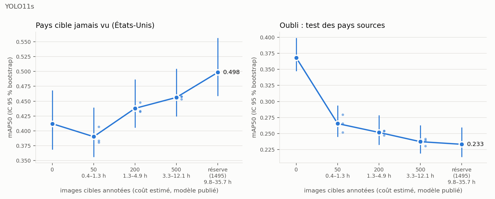

# road-damage-shift

Détection de dégradations de chaussée (fissures longitudinales D00, transversales D10, faïençage D20, nids-de-poule D40) qui reste fiable **dans un pays jamais vu**, **sous le flou de bougé** et **sur CPU**.

> Statut : semaines 1 et 2 terminées (données, baselines, IC, Q1 few-shot). Les `[X]` restants seront remplacés par des résultats d'exécutions réelles tracées dans MLflow.

## Questions de recherche

| # | Question | Coût réel associé |
|---|----------|-------------------|
| Q1 | Combien d'images annotées du pays cible faut-il pour récupérer la performance ? (0 / 50 / 200 / 500) | Coût **estimé** (modèle publié, non mesuré) : 3,3–12,1 h pour 500 images |
| Q2 | Le flou de bougé : défloutage Wiener avant détection ou augmentation par flou à l'entraînement ? | — |
| Q3 | Quelle perte de précision pour quel gain de latence en ONNX / INT8 sur CPU ? | Latence CPU : [X] ms/image |

## Protocole

- **Données** : RDD2022, train annoté uniquement (le test officiel n'a pas d'annotations publiques).
- **Sources** : Japon + Inde + Tchéquie (70 / 15 / 15 %). **Cibles** : États-Unis (principale), Norvège (si disponible) — 1000 images de test figées + une réserve pour le few-shot.
- **Découpage par blocs** d'images consécutives pour limiter la fuite entre images voisines d'un même trajet.
- **Sélection de modèle** sur la validation source uniquement ; les jeux de test ne servent qu'à la mesure finale.
- **Même budget pour les deux modèles** (données, 50 epochs, batch 8, imgsz 640, seed), mais chacun avec le taux d'apprentissage de sa recette d'origine : YOLO11 en `optimizer: auto` d'Ultralytics (AdamW 0,00125), RT-DETR en AdamW 1e-4 (Zhao et al., CVPR 2024). Avec la recette YOLO, l'entraînement de RT-DETR a divergé (NaN persistant).
- Seeds fixées, empreinte sha256 du manifest de données enregistrée dans chaque run MLflow.

### Protocole Q1 (fixé avant les résultats few-shot)

- Fine-tuning du modèle S1 sur k = 50 / 200 / 500 images américaines (3 tirages imbriqués chacun) et sur toute la réserve (plafond) ; k = 0 = modèle S1 seul.
- 30 epochs pour tous les k, lr = lr S1 / 10 (AdamW), une mise à jour des poids par batch (`nbs` = batch = 8 ; avec l'accumulation par défaut d'Ultralytics, k = 50 n'aurait reçu qu'≈ 36 mises à jour, défaut repéré dans les logs du test de fonctionnement et corrigé avant tout résultat few-shot), seed d'entraînement fixe : la variance mesurée vient du choix des images.
- Aucune image cible en dehors des k annotées n'est utilisée : pas de validation cible, on évalue `last.pt`. Seuil du F1 choisi sur la validation source.
- Mesures avec IC bootstrap : test États-Unis figé (adaptation) et test source (oubli).
- **S2b, rejeu** (fixé après les résultats de S2, avant tout résultat avec rejeu) : mêmes runs, mêmes tirages et même recette, avec en plus autant d'images tirées du **train** source que d'images cibles (ratio 1:1, tirage seedé ; jamais d'image de validation ou de test source). Chaque run S2b est comparé à son jumeau S2 (même k, même tirage) sur les mêmes images de test. Le coût d'annotation est inchangé : les images sources sont déjà annotées.
- **Coût d'annotation estimé, pas mesuré** : 7,8 s par image + 7 à 34,5 s par boîte (Su et al. 2012 ; Papadopoulos et al., ICCV 2017), appliqués aux nombres exacts d'images et de boîtes de chaque sous-ensemble. Ces temps viennent d'objets ImageNet bien délimités ; une fissure fine ou un faïençage est probablement plus long à annoter, la borne haute est donc la plus réaliste.

## Résultats S1 : baselines (Japon + Inde + Tchéquie → test source et États-Unis jamais vus)

Valeurs mesurées, IC à 95 % par bootstrap sur les images de test (1 000 tirages). mAP@50 au sens COCO ; F1 micro « CRDDC » (IoU ≥ 0,5, classe correcte) au seuil de confiance choisi sur la validation source (YOLO11s 0,18 ; RT-DETR-l 0,44). mAP@50-95 : valeur Ultralytics, sans IC.

| Modèle | Params (M) | GFLOPs | Entraînement (min, T4) | Test source mAP@50 | Test source F1 | Test source mAP@50-95 | États-Unis (0-shot) mAP@50 | États-Unis (0-shot) F1 |
|---|---:|---:|---:|---:|---:|---:|---:|---:|
| YOLO11s | 9,4 | 21,7 | 82 | 0,368 [0,347 ; 0,399] | 0,428 [0,405 ; 0,452] | 0,154 | 0,412 [0,368 ; 0,468] | 0,497 [0,479 ; 0,513] |
| RT-DETR-l | 32,8 | 109,9 | 346 | 0,353 [0,326 ; 0,387] | 0,430 [0,404 ; 0,455] | 0,142 | 0,312 [0,276 ; 0,371] | 0,415 [0,397 ; 0,433] |

**Ce que montrent ces mesures** (différences avec IC à 95 % ; `results/comparisons_s1.csv`) :

- **En domaine, pas de différence entre les deux modèles** : YOLO11s − RT-DETR-l = +0,015 [-0,012 ; +0,041] en mAP@50 sur le test source (appariée, mêmes images), et aucun écart significatif sur chacun des trois pays sources. RT-DETR-l a pourtant 3,5 × plus de paramètres, 5 × plus de GFLOPs et un entraînement 4 × plus long.
- **Sur le pays jamais vu, YOLO11s généralise mieux** : +0,100 [+0,058 ; +0,143] en mAP@50 et +0,081 [+0,062 ; +0,100] en F1.
- **Le changement de pays ne fait pas chuter YOLO11s** : États-Unis − test source = +0,044 [-0,012 ; +0,108] en mAP@50 (non significatif) et +0,069 [+0,040 ; +0,098] en F1. Pour RT-DETR-l : -0,041 [-0,092 ; +0,018] (non significatif). L'hypothèse de départ (« un pays jamais vu dégrade fortement la détection ») n'est donc pas vérifiée pour cette cible.

Validation de l'évaluation : avec la même formule d'AP, le module `roadshift.eval` reproduit les mAP@50 d'Ultralytics à 0,0012 près sur les 20 évaluations ; les IC calculés sur Kaggle et recalculés hors Kaggle sont identiques.

## Résultats Q1 : adapter YOLO11s aux États-Unis avec k images annotées

Fine-tuning du modèle S1 sur les seules images cibles (protocole ci-dessus). Point de départ k = 0 : mAP@50 0,412 sur le test États-Unis. Gains = différence appariée avec k = 0 sur les mêmes images de test (IC 95 % bootstrap) ; pour 50, 200 et 500, étendue sur les 3 tirages d'images et, entre parenthèses, nombre de tirages où l'écart est significatif, **dans un sens ou dans l'autre** (un écart négatif est une perte). Coût d'annotation **estimé** (modèle publié), pas mesuré.

| k images annotées | Coût estimé | mAP@50 États-Unis (moyenne) | Gain mAP@50 États-Unis | Gain F1 États-Unis | Effet sur le test source (mAP@50) |
|---|---:|---:|---:|---:|---:|
| 50 | 0,4 – 1,3 h | 0,390 | -0,032 à -0,005 (0/3) | -0,043 à -0,027 (3/3) | -0,116 à -0,089 (3/3) |
| 200 | 1,3 – 4,9 h | 0,438 | +0,020 à +0,036 (0/3) | -0,028 à +0,004 (1/3) | -0,121 à -0,114 (3/3) |
| 500 | 3,3 – 12,1 h | 0,456 | +0,041 à +0,046 (3/3) | +0,004 à +0,044 (2/3) | -0,138 à -0,126 (3/3) |
| réserve complète (1 495) | 9,8 – 35,7 h | 0,498 | +0,086 (1/1) | +0,045 (1/1) | -0,135 (1/1) |



*Les barres verticales sont les IC de chaque point pris isolément ; elles se chevauchent alors que les gains appariés du tableau, plus précis (mêmes images), sont significatifs à partir de k = 500.*

**Ce que montrent ces mesures** (`results/fewshot_gains.csv`) :

- **50 images ne suffisent pas** : aucun gain de mAP@50, et le F1 baisse de façon significative sur les 3 tirages.
- **200 images** : gains de mAP@50 positifs mais non significatifs sur les 3 tirages.
- **Gain significatif à partir de 500 images** (≈ 3 à 12 h d'annotation estimées), sur les 3 tirages, d'environ +0,04 de mAP@50 ; la réserve complète (≈ 10 à 36 h) donne le gain le plus net.
- **Oubli massif** : dès 50 images, le fine-tuning sur la seule cible fait perdre ≈ 0,09 à 0,14 de mAP@50 sur les pays sources, de façon significative dans tous les runs. Adapter ainsi le modèle à un nouveau pays le casse pour les anciens.

Variance d'entraînement du modèle S1 (YOLO11s, seeds 42 et 2, `results/comparisons_s1_seeds.csv`) : écart non significatif entre seeds (+0,013 [-0,013 ; +0,040] en mAP@50 sur les États-Unis), bien inférieur à l'avantage de YOLO11s sur RT-DETR-l, qui tient avec le seed 2 (+0,086 [+0,051 ; +0,126]).

## Résultats Q1 (suite) : le rejeu d'images sources contre l'oubli (S2b)

Mêmes runs qu'en S2, avec en plus autant d'images du train source que d'images cibles. Écarts appariés (mêmes images de test, IC 95 %) ; étendue sur les tirages et, entre parenthèses, nombre de runs où l'écart est significatif dans un sens ou dans l'autre.

| k | Gain cible vs k=0, cible seule | Gain cible vs k=0, rejeu | Effet source vs k=0, cible seule | Effet source vs k=0, rejeu | Rejeu − cible seule : mAP@50 source | Rejeu − cible seule : F1 cible |
|---|---:|---:|---:|---:|---:|---:|
| 50 | -0,032 à -0,005 (0/3) | -0,065 à +0,008 (1/3) | -0,116 à -0,089 (3/3) | -0,068 à -0,045 (3/3) | +0,034 à +0,058 (3/3) | +0,038 à +0,052 (3/3) |
| 200 | +0,020 à +0,036 (0/3) | +0,001 à +0,023 (0/3) | -0,121 à -0,114 (3/3) | -0,061 à -0,048 (3/3) | +0,060 à +0,066 (3/3) | +0,024 à +0,062 (3/3) |
| 500 | +0,041 à +0,046 (3/3) | +0,043 à +0,059 (3/3) | -0,138 à -0,126 (3/3) | -0,045 à -0,040 (3/3) | +0,084 à +0,096 (3/3) | +0,035 à +0,050 (3/3) |
| réserve (1 495) | +0,086 (1/1) | +0,080 (1/1) | -0,135 (1/1) | -0,007 (0/1) | +0,128 (1/1) | +0,059 (1/1) |


**Ce que montrent ces mesures** (`results/replay_vs_target_only.csv`, `results/fewshot_gains_replay.csv`) :

- **Le rejeu réduit fortement l'oubli** : à k et tirage égaux, il améliore le mAP@50 sur les pays sources dans les 10 runs, de +0,03 à +0,13. Avec la réserve complète, l'oubli disparaît : mAP@50 source 0,361, écart avec le modèle S1 non significatif.
- **Le gain sur la cible est conservé** : comme sans rejeu, il devient significatif à partir de 500 images (3/3 tirages), et le mAP@50 cible ne diffère pas significativement de la version sans rejeu dans 8 runs sur 10.
- **Le F1 cible est meilleur avec le rejeu dans les 10 runs** (+0,02 à +0,06), probablement parce que le seuil choisi sur la validation source reste mieux calibré quand le modèle continue de voir des images sources.
- Recommandation qui découle de ces mesures : pour adapter le modèle à un nouveau pays, annoter environ 500 images et fine-tuner **avec rejeu**.

## Reproduire

```bash
pip install -e ".[dev,train]"
pytest
python -m roadshift.data.convert --config configs/default.yaml --raw-root <dossier RDD2022>
```
Entraînement : `notebooks/01_baselines_kaggle.ipynb` (GPU T4 Kaggle). IC et comparaisons à partir des sorties d'un run :
```bash
python -m roadshift.eval.report  --runs-dir <run>/ultralytics_run --data <dataset_meta> --model yolo11s --out results/ci_yolo11s.csv
python -m roadshift.eval.compare --run yolo11s=<run_yolo> --run rtdetr_l=<run_rtdetr> --data <dataset_meta> --out results/comparisons_s1.csv
```

## Limites

- Les métadonnées de trajet (GPS, séquence) ne sont pas publiées : le découpage par blocs réduit la fuite sans la garantir.
- Le sous-ensemble États-Unis de RDD2022 ne contient **aucune image sans dégât** (0 / 4 805 XML sans objet, contre 8 % au Japon, 51 % en Inde et 62 % en Tchéquie). Les fausses alertes sur route saine ne sont donc pas mesurables sur le pays cible ; chaque test source est aussi évalué restreint aux images avec au moins un dégât (`*_pos`) pour une comparaison à conditions égales.
- Distribution des classes très différente entre pays (ex. 23 nids-de-poule D40 seulement dans le test États-Unis) : les métriques par classe sur le pays cible sont rapportées avec leur intervalle de confiance.
- **Variance d'entraînement partiellement mesurée** : YOLO11s a 2 seeds (42 et 2), RT-DETR-l un seul (≈ 6 h de GPU par run). Les IC bootstrap couvrent l'aléa de l'échantillon de test, pas celui de l'entraînement.
- **Même budget, pas l'optimum de chaque modèle** : à 50 epochs, la validation de YOLO11s progresse encore (meilleur epoch = 50) alors que RT-DETR-l plafonne (meilleur epoch = 47).
- **Recette de RT-DETR-l modifiée après un incident** : avec le lr « auto » d'Ultralytics (0,00125) en AMP, l'entraînement a divergé (NaN dès l'epoch 6, arrêt après 5 h 43) ; relancé avec le lr de sa recette d'origine (1e-4), sans NaN. Les deux runs n'ont donc pas exactement le même commit (seule la ligne RT-DETR de la config diffère).
- **Petits effectifs par classe** : 2 boîtes D10 dans le test Inde (son mAP@50 est très instable : IC de l'écart entre modèles [−0,137 ; +0,267]) et 23 boîtes D40 dans le test États-Unis. Les AP par classe de ces cas ne sont pas interprétables.
- **Q1, deux recettes seulement** : cible seule et rejeu 1:1, avec 30 epochs et lr / 10 ; d'autres ratios de rejeu ou d'autres durées n'ont pas été testés. Le seuil du F1, fixé sur la validation source, peut être mal calibré pour la cible après fine-tuning, ce qui pénalise surtout le F1 sans rejeu.
- [à compléter avec Q2, Q3]

## Licences

- Code : AGPL-3.0, par cohérence avec **Ultralytics (AGPL-3.0)**, dont ce projet dépend pour YOLO11 et RT-DETR. Un usage commercial fermé nécessiterait une licence Ultralytics Enterprise.
- Données : RDD2022 (Arya et al., 2024), licence **CC BY 4.0**, téléchargées depuis le dépôt figshare officiel (article 21431547, intégrité vérifiée par MD5). Le serveur S3 du challenge n'est plus accessible publiquement.

## Citation des données

Arya, D., Maeda, H., Ghosh, S. K., Toshniwal, D., & Sekimoto, Y. (2024). RDD2022: A multi-national image dataset for automatic road damage detection. *Geoscience Data Journal*.
